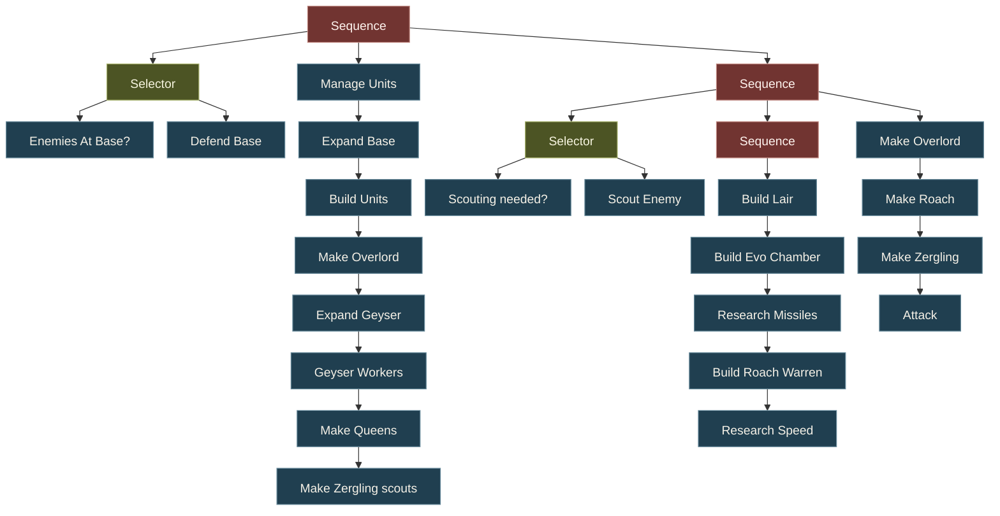

<!--
Answer one question at a time, in full sentences that make sense without the question.
One short paragraph per question is enough to start. Delete each question after answering it.
For an older project, make the timing clear rather than using "yesterday" without context.
Links you can reuse: [the video](#video) and [the behavior tree](#behavior-tree).
Remove this instruction comment when finished.
-->

> **1.** What was this StarCraft project, when did you work on it, who does "we" refer to, and which API were you using?

Back when I was doing my master's in computer science, I took a course about AI and multi-agent systems. During that course, another person and I did a small project where we programmed a behavior tree to be used as a StarCraft bot and showed that it had good enough performance to beat an in-game AI. We were able to integrate our behavior tree code into the real StarCraft game, as Blizzard, at least at the time, supported open-source efforts on the client side of the game. Mind you, I do not think that they open-sourced the entire StarCraft 2 game, but part of the game client definitely was. The game and game client were originally written in C++, and I also wanted to use C++ for this AI project, but the person I did the project with was more well versed in Python, so we made use of some kind of Python variant of the game client. Possibly, this Python "client" was just a small plugin that was somehow ported to the binary or C++. I'm not entirely sure, and this project was done a long time ago. After googling, it looks like it was probably [s2client-api](https://github.com/Blizzard/s2client-api), which is the "client API" enabling one to make one's own SC2 AI.

> **2.** What did you originally want an attack-focused bot to do, and why did you choose that starting point?

As this project was rather time-restricted and the s2client-api, especially the Python variant of it, was underdocumented, I think our strategy was to get the most "bang for the buck", or, in other words, we wanted to make something that, with low effort and relatively low complexity, would still result in decent performance. As I have played StarCraft 2 myself, I know that the gameplay gets progressively more complicated as time goes on and the branching factor of possible game states increases exponentially. Therefore, our best hope was to make some kind of "rush" strategy where our bot would attack the other player as soon as possible and hope to catch them by surprise. Making a bot utilizing a defensive strategy is way harder and much more complicated, as it has to handle more uncertainty and more possible complex scenarios over a longer period of time. If the rush strategy worked, the game would end quickly, and then our bot simply wouldn't have to account for those more sophisticated "long-plays".

## Learning the API

> **3.** What was hardest about learning the API? What is one concrete task that took longer than you expected?

Well, it had to be written in Python, and that meant accounting for run-time errors instead of catching most bugs at compile time. Other than that, there was also a lot of trial and error when using the Python API to see what worked and what did not work. Would calling a certain function make the bot behave as expected? Questions like that were hard to answer without actually trying them out in simulated runs. One task that did take longer than expected was coding the behavior tree logic itself, as we did not really use any existing behavior-tree library or framework. Instead, we coded the behavior tree "data structure" ourselves from scratch. That was trickier than I thought it would be, and as it turns out, there are many ways to implement behavior tree structures. Here, too, we just made the most basic kind of behavior tree possible, with, like, "selector" or "sequence" nodes for picking which branch to execute, and then had relatively simple action nodes for executing tasks. Once all nodes were in the "done" state, I think the tree started over, so all nodes were repeated by the bot.

> **4.** Why did so much of the work shift toward the economy and base management, and how did gathering resources quickly affect the attacking strategy?

There are some well-documented "build order" strategies among StarCraft 2 competitive players. These build orders say in what exact order to build things or recruit units once you have gathered enough resources. These build orders tend to work rather well, at least initially when the game is still at the beginning. Another way to put it is that the game is kind of predictable in terms of what can and cannot happen at the start, as both players have limited possibilities in terms of what actions they can take. Even though the map has "fog of war", it is just not possible for mega big surprises to happen in the first 10-15 minutes. It also helped that the s2client-api had very well-functioning API calls for executing base-building instructions.

## How it works

> **5.** How did the bot's strategy grow beyond attacking to include building the base, scouting and defending? How did those responsibilities fit together?

There are some locations on the map where the opponent is most likely to be, so it makes sense to scout those areas first. Once the scout, with a high probability, mind you, detects the opponent in one such area, it is pretty straightforward to just rush units to that area and have those units cause mayhem. This only really works, of course, if the opponent has not prepared their defences in time. So time is of the essence here for the rush strategy to work.

> **6.** What made the base management dynamic? What is one example of the bot choosing a different action because the game state changed?

This particular behavior tree that we coded was not really that dynamic. The API calls were at a fairly high level, however, and had some flexibility built into them, but we did not write those API calls ourselves; they were just part of the API. For example, one API call could be "make a worker create a certain kind of building", and then the API would automatically find a location on the map to build it on instead of us having to specify the exact X, Y coordinates. The nice thing about behavior trees, however, is that once you have a well-defined tree, you can box it into a single "encapsulation node" that abstracts away all the internal complexity, and then several such "encapsulation nodes" can be combined into a new, more sophisticated tree that has exactly that kind of dynamic or more advanced AI behavior. That would, of course, be potential "future work" for our project.

> **7.** How do sequences, selectors and leaves work in your implementation, and how does one branch of [the behavior tree](#behavior-tree) put them together?

As I remember, it was, for the most part, just normal behavior tree logic. One can easily google how "Selector" and "Sequence" work in more fine-grained detail, but their purpose is just to decide how action nodes are executed and in what order. The "Selector" does some kind of "check", and if that check returns true, then it executes the action node.

### Behavior tree

## Combining the two versions

> **8.** How did you end up with two versions, and what was each one better at? What did you observe in playtests that showed those differences?

What probably happened is that we tried building different kinds of trees and ended up with two that worked okay. Combining these two trees into a bigger one is one of the strengths of behavior trees, as it is very easy to do. s2client-api had this functionality in that you could relatively quickly spin up test runs where you actually ran the game and saw how well your bot performed. You could run the game with or without visuals. If you ran it without visuals, the simulation ran much more quickly, but you could still gather information about the performance via logs or maybe just via some kind of result report object. These test runs allowed us to iteratively test and improve our solutions. Playtests allowed us to see if scouting actually worked or not by observing how likely it was for our scout to actually find the opponent's location. They also allowed us to tweak the scouting paths or how we had it traverse the map. Some paths worked more reliably than others, I think.

> **9.** Which leaf nodes did you want to bring together, and why those particular ones? How far did you get: a completed combination, something partly working, or a plan you could not yet test?

One thing that could cause issues but that our bot resolved by itself over time was that, while it could efficiently discover the opponent's base in one location, if they had managed to expand their base into a second place, we would not continue to scout, or at least not scout as well as we did initially. As we employed a rush strategy, we simply could not afford to allow the enemy to hide for too long; we had to find their base and attack as soon as possible. However, our bot did get lucky in that it was able to find the opponent's second base somewhat by chance, and as our bot's logic was to just spam attack units to wherever that opponent was, it made our bot win the game regardless.

> **10.** What stopped working around the API crashes, and how did that affect combining or testing the versions? When did this happen, and what do you actually know about the cause?

As mentioned, we did use some kind of Python plugin for the game client, while the official one was just pure C++. For some kind of unbeknown-to-us reason, it just stopped working prior to the day of our presentation, but I was smart enough to make video recordings of the game simulations beforehand, just in case some problem like this happened. Speculating now, there may have been some kind of update somewhere in the compute chain which caused issues, but I do not know if this was fixed in later versions of the plugin (or game client).

## Video

> **11.** Which version appears in the recording, and when was it made relative to the crashes? What should the reader watch for that demonstrates this version's strengths?

The video shows our bot in action: it first scouts for the opponent and then employs its "rush strategy", whereby it spams attack units to wherever the opponent can be found on the map. Of course, prior to scouting, it runs its "build order", where it very deterministically builds stuff in a certain order that allows the rush to be made quickly. StarCraft is, in some sense, a game of economics, and if you manage your resources well, you can be more time-efficient.

<iframe
  src="https://drive.google.com/file/d/1AiqmMvl7CTSNtSMx-StarzCNJB8NCt0m/preview"
  title="StarCraft behavior tree demonstration"
  loading="lazy"
  allow="autoplay; fullscreen"
  allowfullscreen
  style="display: block; width: 100%; aspect-ratio: 16 / 9; border: 0; border-radius: 3px; margin: 1.8rem 0;"
></iframe>

[Open the video on Google Drive](https://drive.google.com/file/d/1AiqmMvl7CTSNtSMx-StarzCNJB8NCt0m/view)

## Reflections

> **12.** What did you learn from the difference between your original attack-focused idea and the bot you actually built? What would you combine, change or test next?

I believed that we would micro-manage our bot more, but it turns out the API worked well enough for us to think at a higher abstraction level. It also turns out that if we had really wanted to micro-instruct the bot, then that would have involved a lot more work and would have been a lot harder to actually implement. To me, that just goes to show that behavior trees work well when you have good building blocks to play with. Often, you construct these behavior trees manually, and as with any manual work, it flows better if things are orderly and make sense. The obvious low-hanging fruit regarding future bot improvement is better scouting and also continuing to scout for base expansions after you find the opponent's first base.

[Back to the video](#video)
